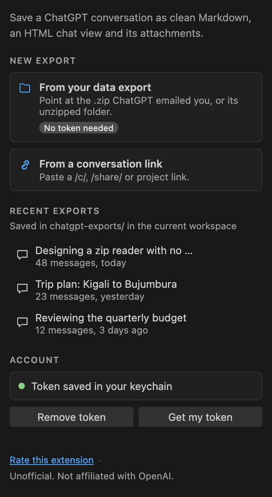

# ChatGPT Markdown Export

Save a ChatGPT conversation as clean Markdown, without leaving your editor.

Useful when you want to hand a conversation to another model, keep it in a repository,
or simply read it offline.

> Unofficial. Not affiliated with OpenAI.



## Features

- **Clean Markdown.** One file, plain `## Author` / `## Assistant` headings, ready for any model.
- **Readable HTML.** The same conversation as a collapsible chat view, with a preview panel inside VS Code.
- **Attachments included.** Images and documents are saved next to the Markdown, with working links.
- **Raw JSON.** The untouched payload, in case you need a field the Markdown drops.
- **Three sources.** Your official ChatGPT data export, a whole project, or a single
  conversation link.
- **Whole projects.** Paste a project link and export every chat in it in one run.
- **No unzipping.** Point at the `.zip` ChatGPT emails you and it is read in place.
- **Export in bulk.** Tick as many conversations as you want and write them all in one run.
- **Safe token storage.** Your bearer token goes to the OS keychain, never to a file.

## Getting started

Open the **ChatGPT Export** icon in the Activity Bar, on the left. Everything happens there:
the two export buttons, your recent exports, and your token.

### Without a token (recommended)

1. In ChatGPT, go to **Settings → Data controls → Export data**, and confirm.
2. Click **From your data export**, and select the `.zip` you get by email. An already
   unzipped folder works too.
3. Tick one conversation, or as many as you want, and confirm.

This works for everyone and exports attachments straight from the archive. In a bulk run,
a conversation that cannot be read is reported at the end and the others still land.

### From a project

1. Click **Bearer token** in the sidebar, and paste your token.
2. Click **From a project**, and paste the project link, the one that ends in `/project`.
3. Tick the conversations you want, then confirm.

ChatGPT forks a conversation under the same name prefixed with `Branch ·`. Those are listed
but left unticked, so you do not export the same thread twice without meaning to.

### From a conversation link

1. Click **Bearer token** in the sidebar, and paste your token.
2. Click **From a ChatGPT link**, and paste the conversation URL.

Supports `/c/`, `/share/` and project links. Public `/share/` links need no token.

### Where to find your bearer token

1. Sign in at [chatgpt.com](https://chatgpt.com).
2. Open [chatgpt.com/api/auth/session](https://chatgpt.com/api/auth/session) in the same browser.
3. Copy the value of `accessToken` from the JSON that appears.

The **Get my token** button in the sidebar opens that page for you.

The token is a session secret, like a password. It expires after a while, so expect to replace
it from time to time. The extension keeps it in your operating system's keychain, never in a
file, and sends it only to `chatgpt.com`.

## Where exports go

Every export is written to **`chatgpt-exports/` at the root of the workspace you currently
have open in VS Code**, one folder per conversation:

```
<your workspace>/
  chatgpt-exports/
    my-conversation-abcd1234/
      conversation.md      clean Markdown
      conversation.html    collapsible chat view
      conversation.json    raw payload
      files/               attachments
```

The panel shows the exact folder above your recent exports. To send them somewhere else, set
`chatgptMdExport.outputDirectory` to another relative path, or to an absolute one. With no
workspace open, exports go to a temporary folder instead.

An attachment that cannot be fetched never stops an export: it becomes a short note in the
Markdown explaining why.

## Settings

| Setting | Default | Description |
| --- | --- | --- |
| `chatgptMdExport.outputDirectory` | `chatgpt-exports` | Where exports go, relative to the workspace root or absolute |
| `chatgptMdExport.authorName` | *(empty)* | Name shown as the author in the export header |
| `chatgptMdExport.downloadAttachments` | `true` | Save attachments alongside the Markdown |
| `chatgptMdExport.accountId` | *(empty)* | Only needed for Team and Enterprise workspaces |
| `chatgptMdExport.openAfterExport` | `preview` | `preview`, `markdown`, or `none` |

## Requirements

VS Code 1.90 or later. Nothing else to install.

## Known limitations

- Link and project modes use chatgpt.com's private API. It can change without notice, and the
  token expires. The panel shows how many days your token has left, and when the format
  changes the extension says so and points you at the data export instead of failing with a
  cryptic error.
- A project export is one request per conversation, so a large project takes a while.
- Conversations you archived in ChatGPT are not listed by a project export.
- Attachments uploaded by another account cannot be downloaded, by design.

## Rate it

If this saved you time, a rating helps other people find it:
**[leave a review on the Marketplace](https://marketplace.visualstudio.com/items?itemName=samandari.chatgpt-md-export-vscode&ssr=false#review-details)**.
It takes ten seconds and it is the single most useful thing you can do for a small extension.

Found a bug or want something added?
[Open an issue](https://github.com/Sama-ndari/chatgpt-md-export/issues).

## Release notes

See the [changelog](CHANGELOG.md).

## Contributing

Source, issues and the CLI version of this tool:
[github.com/Sama-ndari/chatgpt-md-export](https://github.com/Sama-ndari/chatgpt-md-export)

Built by [Samandari](https://samandari.dev). MIT licensed.
